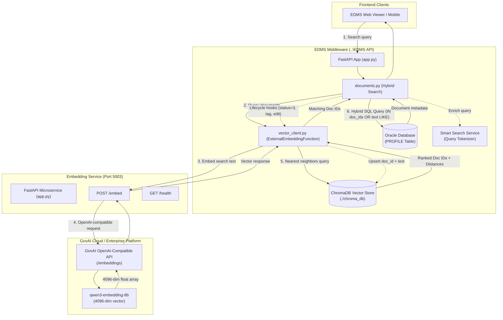
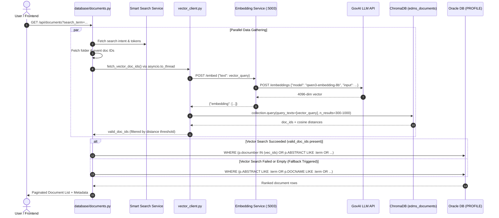
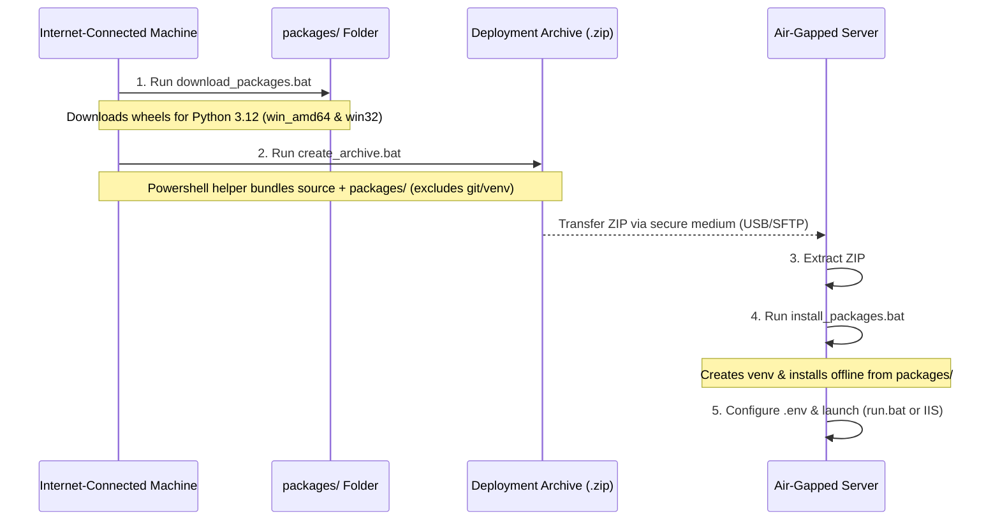

# EDMS Embedding Service

A high-performance, asynchronous FastAPI microservice providing dense vector embeddings for semantic document search across the Enterprise Document Management System (EDMS). The service integrates with the **GovAI LLM Platform** (`qwen3-embedding-8b`, 4096 dimensions) and works as the vector generation engine for the **EDMS Middleware API** (`..\EDMS API`) and **ChromaDB**.

---

## Table of Contents

1. [Overview & Architecture](#1-overview--architecture)
2. [GovAI LLM Integration](#2-govai-llm-integration)
3. [Integration with EDMS API (`..\EDMS API`)](#3-integration-with-edms-api-edms-api)
   - [Architectural Roles](#architectural-roles)
   - [The Indexing (Write) Flow](#the-indexing-write-flow)
   - [The Search (Read) Flow: Hybrid Search & Fallback](#the-search-read-flow-hybrid-search--fallback)
   - [Backfilling Existing Documents](#backfilling-existing-documents)
4. [Project Structure & Code Graph](#4-project-structure--code-graph)
5. [API Specification & Endpoints](#5-api-specification--endpoints)
6. [Configuration & Environment Variables](#6-configuration--environment-variables)
7. [Installation & Local Setup](#7-installation--local-setup)
8. [Offline / Air-Gapped Deployment](#8-offline--air-gapped-deployment)
9. [Production Deployment with IIS (`web.config`)](#9-production-deployment-with-iis-webconfig)
10. [Troubleshooting & FAQs](#10-troubleshooting--faqs)

---

## 1. Overview & Architecture

In modern enterprise document management, traditional keyword-only search (`SQL LIKE '%term%'`) suffers from vocabulary mismatch—it fails to retrieve documents when users search with synonyms, conceptual descriptions, or multilingual equivalents (e.g. Arabic vs. English terminology).

To solve this, the EDMS platform incorporates **Semantic Vector Search**. This **Embedding Service** serves as the dedicated microservice that transforms raw text strings (document abstracts, OCR extracts, metadata, search queries) into high-dimensional numerical vectors.

### High-Level Architecture Diagram



---

## 2. GovAI LLM Integration

The Embedding Service delegates vector computation to the **GovAI LLM Platform** (`llmapi.govai.ae`) using an OpenAI-compatible REST API.

### Key GovAI Specifications

| Parameter | Value | Description |
|---|---|---|
| **Base URL** | `https://llmapi.govai.ae/chat/completions` | Base endpoint configured in `.env` |
| **Transformed URL** | `https://llmapi.govai.ae/embeddings` | Dynamic endpoint used for embeddings |
| **Model** | `qwen3-embedding-8b` | 8-billion parameter dense multilingual embedding model |
| **Output Dimension** | `4096` | High-fidelity embedding representation |
| **Authentication** | Bearer Token | `Authorization: Bearer <GOVAI_API_KEY>` |
| **Timeout** | 60 seconds | Default HTTP timeout per request |

### How URL Translation and Request Formatting Work

In `app.py`, the `get_embedding_from_govai(text: str)` helper translates the configured `GOVAI_API_URL`:

```python
# app.py L62-L73
embedding_url = GOVAI_API_URL.replace("/chat/completions", "/embeddings")

headers = {
    "Content-Type": "application/json",
    "Authorization": f"Bearer {GOVAI_API_KEY}",
}

payload = {
    "model": GOVAI_EMBEDDING_MODEL,  # "qwen3-embedding-8b"
    "input": text,
}
```

The response follows the standard OpenAI embedding format:
```json
{
  "object": "list",
  "data": [
    {
      "object": "embedding",
      "index": 0,
      "embedding": [0.0125, -0.0431, ..., 0.0098]
    }
  ],
  "model": "qwen3-embedding-8b",
  "usage": {
    "prompt_tokens": 15,
    "total_tokens": 15
  }
}
```
The service extracts `result["data"][0]["embedding"]`, verifies that the array is non-empty, and returns it to callers.

### Architectural Evolution: Local Model vs. GovAI LLM

In early development, the service utilized a local SentenceTransformers model (`paraphrase-multilingual-MiniLM-L12-v2`, 384 dimensions) running on PyTorch inside the `local_models/` folder.

**Why the platform migrated to GovAI (`qwen3-embedding-8b`):**
1. **Semantic Fidelity & Bilingual Accuracy**: `qwen3-embedding-8b` delivers superior semantic representation for both Arabic and English administrative terminology compared to small 384-dimensional models.
2. **Resource Footprint**: The local PyTorch/Torchvision setup required gigabytes of server RAM and heavy CPU/GPU computation. Delegating vector generation to GovAI keeps the local microservice extremely lightweight (only `fastapi`, `uvicorn`, `requests`, `python-dotenv`, `pydantic`).
3. **Streamlined Packaging & Portability**: Deployment wheels dropped from over 2GB (Torch/CUDA) to under 20MB, dramatically simplifying air-gapped deployment in enterprise environments.

---

## 3. Integration with EDMS API (`..\EDMS API`)

The primary consumer of this microservice is the main EDMS Middleware application located at `..\EDMS API`.

### Architectural Roles

| Component | Location | Role |
|---|---|---|
| **Embedding Service** | `Embedding Service/app.py` | Standalone FastAPI service running on port `5003`. Accepts text and returns a 4096-dimensional vector via GovAI. |
| **API Client** | `EDMS API/api_client.py` | Provides `get_embedding_from_service(text)` which calls `POST http://localhost:5003/embed` with validation. |
| **Vector Client** | `EDMS API/vector_client.py` | Bridges ChromaDB with the Embedding Service via a custom `ExternalEmbeddingFunction`, managing index persistence and vector searches. |
| **ChromaDB** | `EDMS API/chroma_db/` | Embedded persistent vector database storing collection `edms_documents`. Stores `docnumber` mapped to the 4096-dim vector. |
| **Document Engine** | `EDMS API/database/documents.py` | Implements the hybrid search algorithm, combining vector IDs with Oracle SQL clauses, and provides full fallback. |
| **Backfill Tool** | `EDMS API/backfill_vectors.py` | Command-line script to batch-index existing Oracle documents into ChromaDB. |

---

### The Indexing (Write) Flow

A document is indexed by embedding its `ABSTRACT` field (which contains OCR output, AI summaries, VIP tags, and metadata).

Whenever an abstract is created or updated, `..\EDMS API` calls:
```python
vector_client.add_or_update_document(doc_id: int, text_content: str)
```

Inside `vector_client.py`, ChromaDB's `_get_collection().upsert(...)` delegates embedding generation to `ExternalEmbeddingFunction`:
1. `ExternalEmbeddingFunction.__call__` receives the text.
2. It calls `api_client.get_embedding_from_service(text)`.
3. It validates that the returned vector matches `EXPECTED_EMBEDDING_DIM = 4096`.
4. ChromaDB inserts or updates the vector for ID `str(doc_id)`.

#### Automated Indexing Lifecycle Hooks in `..\EDMS API`

Indexing happens automatically across 4 system lifecycle events:

1. **AI Processing Pipeline (`database/documents.py`)**:
   When the background worker completes media processing (transcription, captioning, OCR) and sets the status to completed (`status = 3`):
   ```python
   if status == 3 and vector_client:
       vector_client.add_or_update_document(int_doc, safe_abstract)
   ```

2. **Manual Abstract / Metadata Edits (`database/documents.py`)**:
   When a user updates document metadata or edits an abstract via `update_document_metadata`:
   ```python
   if vector_client:
       vector_client.add_or_update_document(doc_id, new_abstract)
   ```

3. **VIP Tagging Updates (`database/tags.py`)**:
   When VIP persons are attached or detached from a document:
   ```python
   if vector_client:
       vector_client.add_or_update_document(doc_id, new_abstract)
   ```

4. **Tag / Person Deletion (`database/tags.py`)**:
   When person or keyword tags are removed from a document's abstract, the vector is immediately re-indexed with the updated abstract.

5. **Document Deletion**:
   When a document is permanently purged:
   ```python
   vector_client.delete_document(doc_id)
   ```

---

### The Search (Read) Flow: Hybrid Search & Fallback

When a user searches documents in the EDMS interface:



#### Detailed Search Steps

1. **Query Enrichment**:
   If the `Smart Search Service` is enabled, `database/documents.py` tokenizes the query into conceptual tokens. Any new concepts are appended to the search query before vectorization:
   ```python
   vector_query = f"{search_term} {' '.join(additional_tokens)}"
   ```

2. **Async Vector Retrieval**:
   `fetch_vector_doc_ids()` executes concurrently alongside folder and event searches using `asyncio.gather`. The blocking ChromaDB/HTTP call runs inside a worker thread via `asyncio.to_thread`:
   ```python
   vector_n_results = max(300, min(page * page_size * 5, 1000))
   return await asyncio.to_thread(vector_client.query_documents, vector_query, n_results=vector_n_results)
   ```

3. **Distance Filtering (`VECTOR_DISTANCE_THRESHOLD`)**:
   `vector_client.py` evaluates the distance score for each match. If `VECTOR_DISTANCE_THRESHOLD` is set in `.env`, matches beyond the threshold are filtered out.

4. **Hybrid Query Assembly**:
   In `database/documents.py`, the system merges the vector document IDs, keyword search conditions (`LIKE`), and event conditions with SQL `OR`:
   ```sql
   WHERE (
       p.docnumber IN (:vec_id_0, :vec_id_1, ...)
       OR (p.ABSTRACT LIKE :search_word_0 OR UPPER(p.ABSTRACT) LIKE :search_word_0_upper ...)
       OR (p.docnumber IN (:event_id_0, ...))
   )
   ```

5. **Graceful Fallback Guarantee (Zero Downtime)**:
   If the Embedding Service is offline, network latency causes a timeout, or ChromaDB encounters an error:
   - The error is logged and `vector_doc_ids` returns `None`.
   - The query automatically drops the vector clause and falls back seamlessly to the standard SQL `LIKE` search.
   - **Users experience no downtime or visible search errors.**

---

### Backfilling Existing Documents

To index historical documents stored in Oracle into ChromaDB:

1. Ensure the **Embedding Service** is running on port `5003`.
2. Open a terminal in `..\EDMS API`:
   ```powershell
   cd "d:\projects\new EDMS py\EDMS API"
   .\venv\Scripts\activate
   ```
3. Run `backfill_vectors.py`:
   ```powershell
   python backfill_vectors.py
   ```

#### How `backfill_vectors.py` Operates:
- Connects to Oracle using `db_connector.get_connection()`.
- Queries documents where `FORM = 2740` and `ABSTRACT IS NOT NULL` ordered by `docnumber ASC`.
- Fetches in batches of 100 (`BATCH_SIZE = 100`) using Oracle pagination (`FETCH FIRST :batch_size ROWS ONLY`).
- Calls `vector_client.add_or_update_document(doc_id, abstract)` for each record.
- Automatically handles reconnection if the Oracle session expires.
- Progress is logged every 10 documents per batch.

---

## 4. Project Structure & Code Graph

### Repository Layout

```
Embedding Service/
├── app.py                     # Main FastAPI application & GovAI integration
├── requirements.txt           # Minimal runtime dependencies
├── .env                       # Environment configuration (GovAI credentials & model)
├── .env.example               # Template for environment configuration
├── .gitignore                 # Excludes venv, local_models, packages, logs, etc.
├── run.bat                    # Starts Uvicorn server on port 5003 (4 workers)
├── web.config                 # IIS deployment configuration via httpPlatformHandler
│
├── download_packages.bat      # Downloads wheel files for offline deployment (win32 & win_amd64)
├── create_archive.bat         # Bundles source code + offline wheels into a timestamped ZIP
├── archive_helper.ps1         # PowerShell helper script for clean zip packaging
├── install_packages.bat       # Sets up venv and installs packages offline without internet
│
├── packages/                  # Offline wheel cache (populated by download_packages.bat)
├── local_models/              # Legacy model folder (paraphrase-multilingual-MiniLM-L12-v2)
├── logs/                      # Service runtime logs directory
└── graphify-out/              # Architecture knowledge graph and community analysis
    ├── GRAPH_REPORT.md        # Code community analysis & god-node summaries
    ├── graph.json             # Visual knowledge graph metadata
    └── graph.html             # Interactive browser visualization
```

### Code Communities from Graphify Analysis

The `graphify-out` analysis identified 6 key structural communities:

| Community | Focus | Key Components |
|---|---|---|
| **Community 0** | **Core Service Logic** | `app.py`, `EmbedRequest`, `EmbedResponse`, `HealthResponse`, `get_embedding()`, `get_embedding_from_govai()`, `health_check()` |
| **Community 1** | **Ecosystem Architecture** | System integration documentation, Read Flow, Write Flow, Backfill process |
| **Community 2** | **Configuration & Environment** | `.env`, `.env.example`, environment loading, middleware settings |
| **Community 3** | **Offline Deployment Workflow** | `download_packages.bat`, `install_packages.bat`, wheel packaging |
| **Community 4** | **API Specification** | Request/response schemas, JSON payloads, endpoint routing |
| **Community 5** | **Packaging Automation** | `create_archive.bat`, `archive_helper.ps1`, `Test-Excluded()` filtering |

---

## 5. API Specification & Endpoints

Base URL: `http://localhost:5003` (or configured host/port)

| Method | Endpoint | Description | Request Body | Response Model |
|---|---|---|---|---|
| `POST` | `/embed` | Generates a 4096-dim vector for the given text | `{"text": "..."}` | `EmbedResponse` |
| `GET` | `/health` | Health check & model status | _None_ | `HealthResponse` |
| `GET` | `/docs` | Interactive Swagger UI API documentation | _None_ | HTML |
| `GET` | `/redoc` | Alternative ReDoc API documentation | _None_ | HTML |

---

### Request & Response Schemas

#### `POST /embed`

**Request (`EmbedRequest`):**
```json
{
  "text": "قرار وزاري بشأن تنظيم العمل المالي والإداري"
}
```

**Response (`EmbedResponse` - HTTP 200):**
```json
{
  "text": "قرار وزاري بشأن تنظيم العمل المالي والإداري",
  "embedding": [
    0.012543,
    -0.034521,
    0.089123,
    "..." // 4096 float values
  ]
}
```

**Error Responses:**
- `HTTP 503 Service Unavailable`: Missing GovAI API configuration (URL or API key not set in `.env`).
- `HTTP 502 Bad Gateway`: Failed to connect to the GovAI endpoint (network error, connection refused, or remote timeout).
- `HTTP 500 Internal Server Error`: GovAI returned an unparseable response or empty vector.

#### `GET /health`

**Healthy Response (`HealthResponse` - HTTP 200):**
```json
{
  "status": "healthy",
  "model": "qwen3-embedding-8b",
  "reason": null
}
```

**Unhealthy Response (`HealthResponse` - HTTP 200):**
```json
{
  "status": "unhealthy",
  "model": null,
  "reason": "Missing API configuration"
}
```

---

### Testing with cURL & Python

#### cURL
```bash
# Health check
curl http://localhost:5003/health

# Generate embedding
curl -X POST http://localhost:5003/embed \
  -H "Content-Type: application/json" \
  -d "{\"text\": \"Administrative circular regarding working hours\"}"
```

#### Python
```python
import requests

response = requests.post(
    "http://localhost:5003/embed",
    json={"text": "Administrative circular regarding working hours"},
    timeout=60
)
data = response.json()
print("Vector dimension:", len(data["embedding"]))  # 4096
```

---

## 6. Configuration & Environment Variables

### Embedding Service `.env`

Create a `.env` file in the `Embedding Service/` root directory (copy from `.env.example`):

```dotenv
# GovAI API Configuration
GOVAI_API_URL=https://llmapi.govai.ae/chat/completions
GOVAI_API_KEY=your-govai-api-key-here
GOVAI_EMBEDDING_MODEL=qwen3-embedding-8b

# Optional Port (defaults to 5003)
PORT=5003
```

| Variable | Required | Default | Description |
|---|---|---|---|
| `GOVAI_API_URL` | **Yes** | `https://llmapi.govai.ae/chat/completions` | Base GovAI API URL. Automatically converted to `/embeddings`. |
| `GOVAI_API_KEY` | **Yes** | — | Bearer token for authentication with GovAI. |
| `GOVAI_EMBEDDING_MODEL` | No | `qwen3-embedding-8b` | Name of the embedding model deployed on GovAI. |
| `PORT` | No | `5003` | Local HTTP listener port for Uvicorn. |

### EDMS API `.env` Settings

In `..\EDMS API\.env`, configure the following variables to connect to this service:

```dotenv
# Embedding Service Integration
EMBEDDING_API_URL="http://localhost:5003"
CHROMA_DB_PATH="./chroma_db"
CHROMA_COLLECTION_NAME="edms_documents"
VECTOR_DISTANCE_THRESHOLD=0.35
```

| Variable | Description | Default |
|---|---|---|
| `EMBEDDING_API_URL` | Base URL of this Embedding Service | `http://localhost:5003` |
| `CHROMA_DB_PATH` | Path to persistent ChromaDB storage (shared NAS mount in load-balanced setups) | `./chroma_db` |
| `CHROMA_COLLECTION_NAME` | ChromaDB collection name | `edms_documents` |
| `VECTOR_DISTANCE_THRESHOLD` | Maximum distance cutoff for semantic results (optional) | _None_ (no cutoff) |

---

## 7. Installation & Local Setup

### Prerequisites
- **Python 3.10+** (Python 3.12 64-bit recommended)
- Valid GovAI API Key with access to `qwen3-embedding-8b`

### Steps

1. **Open a terminal in the project directory:**
   ```powershell
   cd "d:\projects\new EDMS py\Embedding Service"
   ```

2. **Create and activate a virtual environment:**
   ```powershell
   python -m venv venv
   .\venv\Scripts\activate
   ```

3. **Install dependencies:**
   ```powershell
   pip install -r requirements.txt
   ```

4. **Configure environment:**
   Copy `.env.example` to `.env` and fill in your `GOVAI_API_KEY`.

5. **Start the service:**
   Using the provided batch script:
   ```powershell
   .\run.bat
   ```
   Or directly with Uvicorn:
   ```powershell
   uvicorn app:app --host 0.0.0.0 --port 5003 --workers 4
   ```

6. **Verify installation:**
   Navigate to [http://localhost:5003/docs](http://localhost:5003/docs) or [http://localhost:5003/health](http://localhost:5003/health).

---

## 8. Offline / Air-Gapped Deployment

In enterprise and government environments, production servers often operate without direct internet access. A three-step deployment workflow handles this:



### Step 1: On an Internet-Connected Machine
1. Run `download_packages.bat`.
   - Downloads standard wheels from `requirements.txt`.
   - Explicitly downloads binaries for Python 3.12 64-bit (`--platform win_amd64`) and 32-bit (`--platform win32`) into `packages/`.
2. Run `create_archive.bat`.
   - Calls `archive_helper.ps1` to stage all Git-tracked source files plus the `packages/` directory.
   - Generates a timestamped file: `..\Embedding_Service_YYYY-MM-DD_HH-mm-ss.zip`.

### Step 2: On the Offline Production Server
1. Copy and extract the ZIP archive to the target directory.
2. Run `install_packages.bat`.
   - Automatically creates a new `venv`.
   - Creates the `logs/` directory.
   - Installs wheels offline with:
     ```bash
     pip install --no-index --find-links=packages -r requirements.txt
     ```
3. Create the `.env` file with production GovAI credentials.
4. Run `run.bat` or configure IIS.

---

## 9. Production Deployment with IIS (`web.config`)

For Windows Server environments running Microsoft IIS, the service includes a pre-configured `web.config` utilizing `httpPlatformHandler`.

```xml
<?xml version="1.0" encoding="UTF-8"?>
<configuration>
    <system.webServer>
        <handlers>
            <add name="httpPlatformHandler" path="*" verb="*" modules="httpPlatformHandler" resourceType="Unspecified" />
        </handlers>
        <httpPlatform processPath="%HOME%\site\wwwroot\venv\Scripts\python.exe"
                      arguments="-m uvicorn app:app --host 0.0.0.0 --port %HTTP_PLATFORM_PORT%"
                      startupTimeLimit="60"
                      processesPerApplication="16"
                      requestTimeout="00:02:00"
                      stdoutLogEnabled="true"
                      stdoutLogFile="%HOME%\LogFiles\embedding_service.log">
            <environmentVariables>
                <environmentVariable name="GOVAI_API_URL" value="https://llmapi.govai.ae/chat/completions" />
                <environmentVariable name="GOVAI_API_KEY" value="YOUR_GOVAI_API_KEY_HERE" />
                <environmentVariable name="GOVAI_EMBEDDING_MODEL" value="qwen3-embedding-8b" />
            </environmentVariables>
        </httpPlatform>
    </system.webServer>
</configuration>
```

### IIS Configuration Highlights
- **`httpPlatformHandler`**: Forwards inbound HTTP traffic directly to Uvicorn via dynamic port assignment (`%HTTP_PLATFORM_PORT%`).
- **`processesPerApplication="16"`**: Spawns worker processes to maximize multi-core server throughput.
- **`requestTimeout="00:02:00"`**: 2-minute request timeout to accommodate large batch payloads.
- **Logging**: Captures stdout/stderr into `%HOME%\LogFiles\embedding_service.log` for troubleshooting.

---

## 10. Troubleshooting & FAQs

### Q1: ChromaDB reports `Dimension mismatch detected: Collection 'edms_documents' has 384-dim embeddings, but embedding service is configured for 4096 dimensions`
- **Cause**: The existing ChromaDB collection was created with the legacy `paraphrase-multilingual-MiniLM-L12-v2` model (384 dimensions), whereas the current GovAI model (`qwen3-embedding-8b`) produces 4096 dimensions.
- **Resolution**:
  1. Back up the old directory: `ren chroma_db chroma_db_384_backup`.
  2. Start the main `..\EDMS API` application to allow it to initialize a fresh `chroma_db` collection for 4096 dimensions.
  3. Run `python backfill_vectors.py` in `..\EDMS API` to re-index documents using the GovAI model.

### Q2: Service returns `HTTP 503 Service Unavailable: Missing API credentials`
- **Cause**: The `.env` file does not exist, or `GOVAI_API_URL` / `GOVAI_API_KEY` are not populated.
- **Resolution**: Ensure `.env` exists in `Embedding Service/` with valid values, or confirm the environment variables are declared in `web.config` for IIS deployments.

### Q3: Service returns `HTTP 502 Bad Gateway: Failed to connect to embedding API`
- **Cause**: Network firewall, proxy block, or DNS failure preventing the server from reaching `llmapi.govai.ae`.
- **Resolution**: Check egress firewall rules on port 443 to `llmapi.govai.ae`. Test connectivity via PowerShell:
  ```powershell
  Test-NetConnection -ComputerName llmapi.govai.ae -Port 443
  ```

### Q4: Search in EDMS works, but vector search results do not appear
- **Cause**: EDMS API includes automatic fallback. If `vector_client.py` fails to reach `http://localhost:5003/embed`, it logs the warning and falls back to standard SQL `LIKE` search without throwing user-facing errors.
- **Resolution**:
  1. Check if the Embedding Service is running on port 5003: `curl http://localhost:5003/health`.
  2. Verify `EMBEDDING_API_URL="http://localhost:5003"` is present in `..\EDMS API\.env`.
  3. Check `..\EDMS API` terminal logs for `Vector search failed` or `External embedding failed` messages.